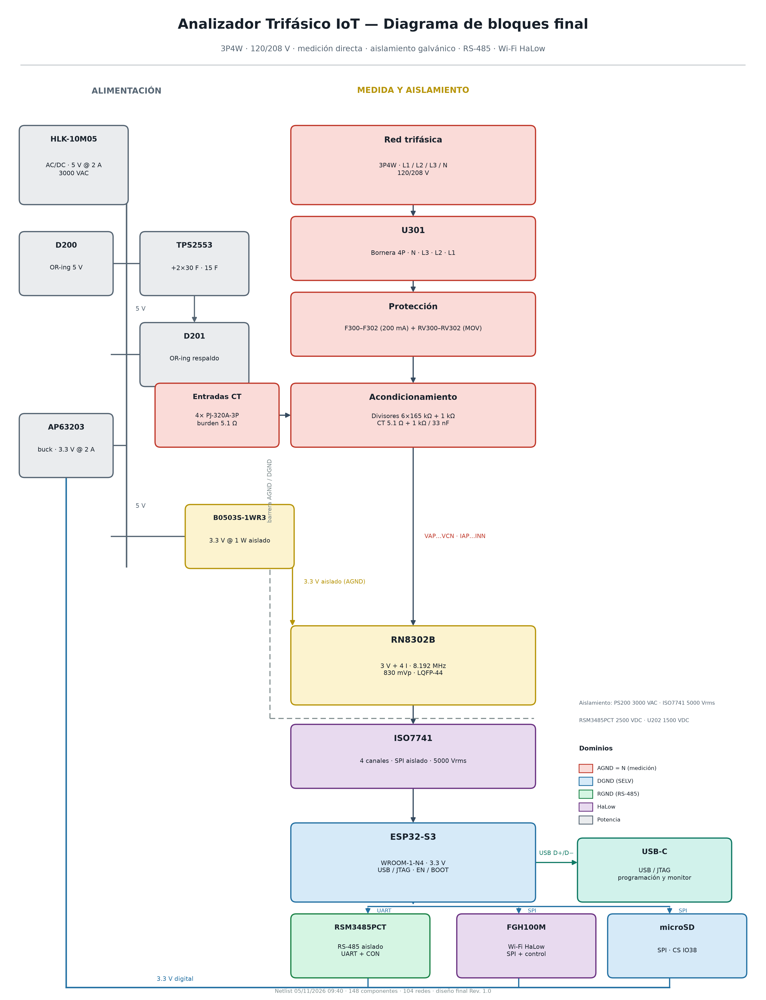

# Analizador Trifásico IoT

> Instrumento electrónico industrial de **medición eléctrica trifásica** con conectividad **IoT**.
> Orientado a instalaciones industriales y motores: registro de consumo, variables eléctricas a múltiples escalas de tiempo, comunicación **Modbus RTU / RS-485** y enlace inalámbrico **Wi-Fi HaLow**.

**Estado del diseño:** diseño final **Rev. 1.0 (05/11/2026)** — esquemáticos capturados, layout en curso.

---

## 🧭 Diagrama de bloques final

Este es el diseño vigente. Toda decisión de hardware debe ser consistente con este diagrama:

📎 [`Diagrama_de_bloques_final.pdf`](documentation/Diagrama_de_bloques_final.pdf) · [`PNG`](documentation/Diagrama_de_bloques_final.png) · [`SVG`](documentation/Diagrama_de_bloques_final.svg)



> El diagrama V2 (`documentation/Diagrama de bloquesv2.pdf`, 07/10/2026) se conserva como historial. El diseño vigente es el de esta página.

---

## 🔧 Arquitectura por bloque

### 1. Entrada de potencia trifásica

| Elemento | Componente | Notas |
|---|---|---|
| Entrada | **Red trifásica L1 / L2 / L3 / N** | **3P4W, 120/208 V** |
| Conector | **U301** — bornera 4 vías, 5 mm | N · L3 · L2 · L1, 10 A |
| Protección | **F300–F302** + **RV300–RV302** | Fusibles 2410 *time-lag* + MOV-14D471K por fase |
| Entrada de CT | **4× HX PJ-320A-3P DIP** (U300, U302, U303, U304) | Tres fases + neutro |

**Conexionado de los jacks de CT:** pin 2 = *tip* (señal), pin 3 = *sleeve* (retorno), pin 4 = *switch*. El pin 4 se une al pin 3 para cortocircuitar el CT cuando no hay plug; al insertar el plug, el switch abre y el CT queda con su burden. Cada pierna lleva **5.1 Ω** a AGND, **1 kΩ** en serie y **33 nF** de filtro.

> Hoja: `THREE PHASES.SchDoc`

### 2. Acondicionamiento analógico

| Elemento | Descripción |
|---|---|
| Canales de tensión | 3 canales diferenciales: **6×165 kΩ + 1 kΩ** por fase, **33 nF** a AGND |
| Canales de corriente | 4 canales diferenciales: burden **5.1 Ω** por pierna, **1 kΩ** serie, **33 nF** |
| Rango del AFE | **830 mVp** por canal diferencial |
| Filtrado | RC de entrada y guard ring en el layout |

El divisor de tensión usa resistencias de **165 kΩ ±0.1 %** y **1 kΩ** en la base. El burden de corriente es de **10.2 Ω diferencial** (5.1 Ω por pierna), compatible con un CT de **100 A / 40 mA** (577 mVp).

> Hoja: `THREE PHASES.SchDoc` (derivaciones) + `MEASURES.SchDoc`

### 3. AFE metrológico

| Elemento | Componente |
|---|---|
| Medidor | **RENERGY RN8302B** (LQFP-44) |
| Canales | 3 de tensión + 4 de corriente, diferenciales |
| Reloj | Cristal **8.192 MHz** (`049ss2-8.192f12dzlal`) |
| Desacople | 10 µF + 100 nF por riel, 1 µF local, ferrita FB100 |
| Alimentación | **AVCC/DVCC 3.3 V** desde el dominio de medida |

Calcula V, I, P, Q, S, PF y THD internamente. El ESP32-S3 lee los registros por SPI a través del ISO7741.

> Hoja: `MEASURES.SchDoc`

### 4. Aislamiento galvánico

| Elemento | Componente |
|---|---|
| Aislador digital | **TI ISO7741DWR** (4 canales, 5000 Vrms) |
| Alimentación aislada del AFE | **B0503S-1WR3** (5 V → 3.3 V, 1 W, 1500 VDC) |
| Señales aisladas | **SPI de 4 hilos** entre RN8302B y ESP32-S3 |

**Mapa del SPI aislado:**

| Señal | ESP32-S3 | ISO7741 | RN8302B |
|---|---|---|---|
| MOSI | `IO14` (pin 22) | INA 3 → OUTA 14 | SDI 35 |
| CS | `IO21` (pin 23) | INB 4 → OUTB 13 | SCSN 34 |
| CLK | `IO47` (pin 24) | INC 5 → OUTC 12 | SCLK 33 |
| MISO | `IO48` (pin 25) | OUTD 6 ← IND 11 | SDO 32 |

El dominio de medida queda referenciado a **AGND = N**; el dominio digital a **DGND**; el RS-485 a **RGND**. El ISO7741 y el B0503S son los puentes de la barrera.

> Hoja: `MEASURES.SchDoc`

### 5. Procesamiento

| Elemento | Componente |
|---|---|
| MCU | **ESP32-S3-WROOM-1-N4** |
| Programación | **USB-C** (`CON_USB_TYPEC_16P`) — USB nativo / JTAG integrado |
| Monitorización | Puerto serie por USB |
| Arranque | Botones **EN** y **BOOT**, RC de 10 kΩ + 1.1 µF |

> Hoja: `MCU.SchDoc`

### 6. Alimentación

| Riel | Componente | Capacidad | Destino |
|---|---|---|---|
| AC/DC principal | **Hi-Link HLK-10M05** | 5 V @ 2 A (10 W) | Riel de 5 V y respaldo |
| OR-ing de 5 V | **D200** (MS2A40LWS) | — | `Vin_buck_5V` |
| Carga de respaldo | **TPS2553DRVR** + **2×30 F** | 15 F equivalentes | *Last Gasp* |
| OR-ing de respaldo | **D201** (MS2A40LWS) | — | `Vin_buck_5V` |
| Riel digital | **AP63203WU-7** | **3.3 V @ 2 A** | ESP32-S3, SD, RS-485, HaLow |
| Riel de medida | **B0503S-1WR3** | **3.3 V @ 1 W aislado** | RN8302B, ISO7741 lado 2 |

#### Presupuesto de corriente del riel 3.3 V

| Carga | Consumo |
|---|---:|
| ESP32-S3-WROOM | 500 mA |
| Quectel FGH100M (Wi-Fi HaLow) | 350 mA |
| microSD | 200 mA |
| VISOM RSM3485PCT (RS-485) | 90 mA |
| RN8302B + ISO7741 | 20 mA |
| **Total** | **1 160 mA** |
| Capacidad del buck AP63203 | 2 000 mA |
| **Margen** | **840 mA (42 %)** |

#### Respaldo *Last Gasp*

- Banco: **2×30 F = 15 F** equivalentes, cargado a ≈4.6 V.
- Energía útil hasta ≈4.2 V: **≈26 J**.
- Autonomía: **≈8 s a 3.2 W**, suficiente para cerrar el registro y notificar.
- La rama de carga se limita con el **TPS2553**; el detalle de coordinación está en `REPORT.md`.

> Hoja: `POWER.SchDoc`

### 7. Periféricos

| Periférico | Componente | Interfaz con el ESP32-S3 | Consumo |
|---|---|---|---|
| **RS-485** | **VISOM RSM3485PCT** | UART `IO17/IO18` + `CON` `IO16` | 90 mA |
| **Wi-Fi HaLow** | **Quectel FGH100M** (módulo externo) | SPI compartido + control | 350 mA (3.3 V) |
| **Almacenamiento** | **microSD** (`tf-card-9p`) | SPI `IO11/IO12/IO13`, CS `IO38` | 200 mA |
| **USB** | **USB-C** | D−/D+ `IO19/IO20` | — |

**Conexión del módulo HaLow (headers 500/501):**

| Header | Pin | Señal | GPIO |
|---|---:|---|---|
| 500 | 1 | `RST_H` | `IO5` |
| 500 | 2 | `WK_IN_H` | `IO6` |
| 500 | 3 | `SPI_IRQ_H` | `IO7` |
| 500 | 4 | `SPI_CS_H` | `IO10` |
| 501 | 2 | `SPI_CLK_H` | `IO12` |
| 501 | 3 | `SPI_MISO_H` | `IO13` |
| 501 | 4 | `SPI_MOSI_H` | `IO11` |
| 501 | 5 | 3.3 V | — |
| 501 | 6 | DGND | — |
| 501 | 7 | 5 V | — |

La microSD y el FGH100M comparten el bus SPI (`IO11/IO12/IO13`) con CS independientes (`IO38` y `IO10`). El RN8302B tiene un bus SPI dedicado y aislado, por lo que no comparte MISO con la SD ni con el HaLow.

> Hojas: `MCU.SchDoc` + `INTERFACES.SchDoc`

---

## 📌 Mapa de interfaces del ESP32-S3-WROOM

| Interfaz | Pines | Hacia |
|---|---|---|
| SPI aislado del AFE | `IO14` MOSI, `IO21` CS, `IO47` CLK, `IO48` MISO | RN8302B vía ISO7741 |
| SPI de microSD / HaLow | `IO11` MOSI, `IO12` CLK, `IO13` MISO | microSD (`CS IO38`) y FGH100M (`CS IO10`) |
| UART RS-485 | `IO17` TX, `IO18` RX, `IO16` CON | RSM3485PCT |
| Control HaLow | `IO5` RST, `IO6` WAKE, `IO7` IRQ, `IO10` CS | Headers 500/501 |
| USB | `IO19` D−, `IO20` D+ | USB-C |
| Arranque | `IO0` BOOT, pin 3 EN | Botones y RC |
| Tarjeta SD | `IO9` CD | Conector microSD |

---

## ⚡ Arquitectura de energía

```
Red 3P4W 120/208 V
        │
        └──► U301 ─► F300 ─► HLK-10M05 (5 V @ 2 A)
                                   │
                                   └──► D200 ─► 5 V (Vin_buck_5V)
                                              ├──► AP63203 ─► 3.3 V digital
                                              │        └──► ESP32-S3 · microSD · RS-485 · HaLow
                                              ├──► TPS2553 ─► 2×30 F (15 F) ─► D201 ─► 5 V respaldo
                                              └──► B0503S-1WR3 ─► 3.3 V aislado ─► RN8302B + ISO7741
```

El **HLK-10M05** es la única fuente AC/DC y alimenta el riel de 5 V. El **AP63203** genera el riel digital de 3.3 V; el **B0503S-1WR3** genera el riel aislado de 3.3 V para el AFE. El **TPS2553** carga el banco de supercapacitores y el **D201** lo conecta al riel de 5 V durante el respaldo.

---

## 🗂️ Estructura del repositorio

```
Analizador trifasico IoT/
├── README.md
├── REPORT.md                       ← auditoría pin a pin y verificaciones de cierre
├── CONTRIBUTING.md                 ← guía de trabajo en equipo
├── INSTRUCCIONES.md                ← guía de layout y fabricación
├── AGENTS.md                       ← reglas para agentes de IA
├── .gitignore / .gitattributes
│
├── hardware/
│   ├── altium/                     ← Proyecto Altium Designer (fuente de verdad)
│   │   ├── Analizador_trifasico_IoT_pcb.PrjPcb
│   │   ├── Analizador_trifasico_IoT_pcb.PrjPcbStructure
│   │   ├── MAIN.SchDoc             ← hoja raíz
│   │   ├── THREE PHASES.SchDoc     ← entrada trifásica, CT y divisores
│   │   ├── POWER.SchDoc            ← alimentación, respaldo y rieles
│   │   ├── MEASURES.SchDoc         ← RN8302B + ISO7741 + cristal
│   │   ├── MCU.SchDoc              ← ESP32-S3, USB-C, EN/BOOT
│   │   ├── INTERFACES.SchDoc       ← RS-485, microSD, headers HaLow
│   │   └── Analizador_PCB.PcbDoc   ← layout
│   │
│   └── libraries/                  ← Biblioteca única del proyecto
│       ├── Library_Analizador.LibPkg
│       ├── Schlib1.SchLib
│       ├── PcbLib1.PcbLib
│       └── Library_Analizador.IntLib
│
├── documentation/
│   ├── Diagrama_de_bloques_final.pdf / .png / .svg
│   ├── Diagrama de bloquesv2.pdf   ← historial
│   ├── application-note/           ← nota de aplicación (LaTeX + PDF)
│   ├── revision_v3/                ← diagramas de la revisión anterior
│   ├── wifi-module-halow-xiao/     ← documentación del módulo HaLow
│   └── RD_EM_01_Industrial_Energy_Monitor.pdf
│
├── references/
│   ├── datasheets/
│   ├── application-notes/
│   └── reference-designs/
│
└── software/                       ← herramientas de visualización y pruebas
```

> `INSTRUCCIONES.md` conserva la guía de layout de la revisión anterior. Para la conectividad vigente usa `REPORT.md` y el netlist del 05/11/2026.

---

## 🔌 Hojas del esquemático

| # | Archivo | Contenido | Componentes clave |
|---|---|---|---|
| 1 | `MAIN.SchDoc` | Hoja raíz: solo *sheet symbols* | — |
| 2 | `THREE PHASES.SchDoc` | Entrada trifásica, CT y divisores | U301, F300–F302, RV300–RV302, U300/U302/U303/U304, R303–R339, C300–C313 |
| 3 | `POWER.SchDoc` | Alimentación, respaldo y rieles | HLK-10M05, D200/D201/D202, TPS2553, 2×30 F, AP63203, B0503S-1WR3 |
| 4 | `MEASURES.SchDoc` | AFE metrológico y aislamiento | RN8302B, ISO7741, cristal 8.192 MHz, desacople |
| 5 | `MCU.SchDoc` | Procesamiento y USB | ESP32-S3-WROOM-1-N4, USB-C, EN/BOOT |
| 6 | `INTERFACES.SchDoc` | Comunicaciones y almacenamiento | RSM3485PCT, tf-card-9p, headers 500/501, SM712 |

---

## 📚 Referencias técnicas

### `references/datasheets/`

| Archivo | Componente |
|---|---|
| `RN8302B_Datasheet_v3.pdf` | RENERGY RN8302B — AFE metrológico |
| `RN8302B_User_Manual_v1.1.pdf` | RENERGY RN8302B — manual de usuario |
| `ESP32-S3_Datasheet_en.pdf` | Espressif ESP32-S3 — SoC |
| `ESP32-S3_Technical_Reference_Manual_en.pdf` | Espressif ESP32-S3 — manual técnico |
| `ESP32-S3-WROOM_Module.pdf` | Espressif ESP32-S3-WROOM-1-N4 — módulo |
| `ISO7741DWR_Datasheet.pdf` | TI ISO7741 — aislador digital cuádruple |
| `EVISUN B0503S-1WR3.pdf` | B0503S-1WR3 — DC-DC aislado 5 V → 3.3 V |
| `TI TPS2553DRVR.pdf` | TPS2553 — interruptor/cargador limitado |
| `AP63203WU-7_Datasheet.pdf` | AP63203 — buck 3.3 V |
| `HLK-10M05_Datasheet.pdf` | Hi-Link HLK-10M05 — AC/DC 5 V 2 A |
| `RSM3485PCT_Datasheet.pdf` | VISOM RSM3485PCT — RS-485 aislado |
| `TF-CARD-9P_Datasheet.pdf` | Conector microSD |
| `HX-PJ-320A-3P_Datasheet.pdf` | Jack PJ-320A-3P |
| `Supercapacitor_Datasheet.pdf` | Supercapacitor HP-2R7-J306VYJ23 |
| `JFC2410-0200TS_Datasheet.pdf` | Fusible 2410 |
| `MOV-14D471K_Datasheet.pdf` | Varistor MOV-14D471K |

### `references/application-notes/`

| Archivo | Contenido |
|---|---|
| `TI_DUF27A_Application_Note.pdf` | TI DUF27A — nota de aplicación |
| `TI_DUF27A_Layout.pdf` | TI DUF27A — guías de layout |
| `wifi-halow-module-for-xiao.md` | Notas del módulo Wi-Fi HaLow |

### `references/reference-designs/`

| Carpeta | Contenido |
|---|---|
| `EVAL-ADE9430/` | Analog Devices EVAL-ADE9430 — referencia de AFE trifásico |
| `WI-FI_HALOW_FGH100M_EXT01_V30/` | Módulo HaLow: PCB, esquemático PDF e importación a Altium |
| `HX PJ-320A-3P DIP/` | Conector HX PJ-320A-3P DIP — footprint y símbolo |
| `TI_DCG_v3/` | Gerber / ODB++ de referencia |

---

## 🚀 Cómo empezar a colaborar

> 📘 **Guía completa paso a paso: [`CONTRIBUTING.md`](CONTRIBUTING.md)**

### Ciclo de trabajo

```bash
git checkout main
git pull
git checkout -b feature/mi-tarea
# ... trabajar en Altium, guardar y CERRAR Altium ...
git status
git add .
git commit -m "MEASURES: ajusta rango de ADC de corriente"
git push -u origin feature/mi-tarea
# → Pull Request en GitHub → revisión → merge → borrar rama
```

Si `main` avanzó antes del merge:

```bash
git checkout main && git pull
git checkout feature/mi-tarea
git merge main
git push
```

> ⚠️ **Cierra Altium antes de `git pull`, `git checkout` o `git merge`.** Si está abierto, sobrescribe el archivo al guardar y se pierde el trabajo del compañero.

### Reglas de colaboración

Los archivos `.SchDoc`, `.PcbDoc`, `.SchLib` y `.PcbLib` son **binarios** (contenedores OLE2):

| Git **SÍ** puede | Git **NO** puede |
|---|---|
| Guardar el historial completo | Mostrar diffs de contenido (`Binary files differ`) |
| Revertir a cualquier versión | Fusionar cambios automáticamente |
| Crear ramas independientes | Resolver conflictos de merge |

1. **Una persona por archivo a la vez.** En especial `Analizador_PCB.PcbDoc` — es monolítico.
2. **Una rama por tarea**, nunca trabajes directamente en `main`.
3. **Nunca dos personas en la misma rama ni el mismo archivo en dos ramas.**
4. **Cierra Altium antes de cualquier operación de Git.**
5. **Si hay conflicto de merge en un binario**, no lo edites a mano: coordina con el compañero y rehaz el cambio en Altium sobre la versión que quede en `main`.

---

## 📄 Convención de commits

```
<hoja o bloque>: <descripción corta en imperativo>

THREE PHASES: ajusta entrada de CT
POWER: actualiza respaldo de supercaps
MEASURES: ajusta desacople del RN8302B
MCU: conecta SPI de la microSD
INTERFACES: ordena headers del HaLow
PCB: enruta zona de potencia
LIB: actualiza símbolo del RSM3485PCT
DOC: actualiza diagrama de bloques final
```

---

## 📊 Estado del proyecto

**Diseño final**
- [x] Arquitectura de hardware Rev. 1.0 (05/11/2026)
- [x] Diagrama de bloques final (PDF/PNG/SVG)
- [x] Esquemáticos de las 6 hojas capturados
- [x] Netlist y BOM del proyecto
- [x] Biblioteca única del proyecto
- [x] Nota de aplicación y documentación de referencia

**Verificaciones de cierre antes de fabricar**

| Tema | Verificación |
|---|---|
| CT | Seleccionar el modelo (100 A / 40 mA recomendado), confirmar burden 5.1 Ω y 830 mVp. |
| Entrada | Confirmar 120/208 V, coordinación de F300 con el HLK-10M05 y U301/PE. |
| Aislamiento | Verificar creepage/clearance de AGND, DGND y RGND. |
| BOM | Reexportar desde el `.BomDoc` y verificar los 148 componentes. |
| Altium | ERC/DRC, huellas y `Library_Analizador.IntLib`. |
| HaLow | Confirmar pinout del FGH100M y cableado de los headers 500/501. |
| EMC / seguridad | Filtro EMI, ESD y definición del gabinete (Clase I/II). |
| Producción | Test points, fiduciales y revisión de Gerbers. |

> La auditoría detallada, los cálculos y las acciones de cierre están en [`REPORT.md`](REPORT.md).

---

## 📄 Licencia

Proyecto académico — Universidad Nacional de Colombia, Facultad de Ingeniería.
Uso académico. Verificar autorización institucional antes de cualquier distribución pública.

---

## 🔗 Enlaces útiles

- [Altium — Git Version Control](https://www.altium.com/documentation/altium-designer/using-external-version-control/git)
- [Altium — Using External Version Control](https://www.altium.com/documentation/altium-designer/using-external-version-control)
- [KiCad — importación de archivos Altium](https://dev-docs.kicad.org/en/import-formats/altium/index.html)
