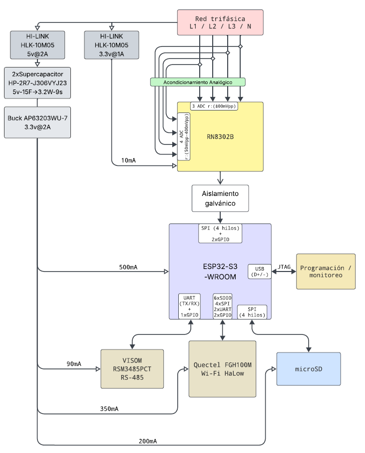

# Analizador Trifásico IoT

> Instrumento electrónico industrial de **medición eléctrica trifásica** con conectividad **IoT**.
> Orientado a instalaciones industriales y motores: registro de consumo, variables eléctricas a múltiples escalas de tiempo, comunicación **Modbus RTU / RS-485** y enlace inalámbrico **Wi-Fi HaLow**.

**Estado del diseño:** diagrama de bloques **V2 (07/10/2026)** — esquemáticos capturados, layout en curso.

---

## 🧭 Diagrama de bloques (V2)

Este es el diseño vigente. Toda decisión de hardware debe ser consistente con este diagrama.



> 📎 El mismo diagrama también está en PDF: [`Diagrama de bloquesv2.pdf`](documentation/Diagrama%20de%20bloquesv2.pdf)

---

## 🔧 Arquitectura por bloque

### 1. Entrada de potencia trifásica

| Elemento | Componente | Notas |
|---|---|---|
| Entrada | **Red trifásica L1 / L2 / L3 / N** | Topología `3P4W` y `3P3W` |
| Conector | **HX PJ-320A-3P DIP** (x4) | Entrada de potencia y CTs |
| Puente rectificador | **BR-50126V-4P0G56** | Rectificación de la red |
| Protección | **MOV-14D471K** (x3) + **FUSE_MOV_JFC2410** (x3) | Varistores + fusibles por fase |

> Hoja: `THREE PHASES.SchDoc`

### 2. Acondicionamiento analógico

| Elemento | Descripción |
|---|---|
| **Acondicionamiento Analógico** | Bloque de divisores resistivos de precisión y filtrado RC para las entradas de tensión y corriente del AFE |

Alimenta al RN8302B con:
- **3 ADC de tensión** → rango ≈ **800 mVpp**
- **4 ADC de corriente** → rango ≈ **150 mVpp** (adaptativo según CT / Rogowski)

> Hoja: `THREE PHASES.SchDoc` (derivaciones) + `MEASURES.SchDoc`

### 3. AFE metrológico

| Elemento | Componente |
|---|---|
| Medidor | **RENERGY RN8302B** |
| ADC de tensión | 3 canales diferenciales, ≈ 800 mVpp |
| ADC de corriente | 4 canales diferenciales, ≈ 150 mVpp (adaptativo) |
| Reloj de metrología | Cristal dedicado (**Crystal_049ss2**) |
| Desacople | 4x 100 nF, 2x 10 µF, 1x 1 µF |

Calcula V, I, P, Q, S, PF y THD internamente en su DSP de energía.

> Hoja: `MEASURES.SchDoc`

### 4. Aislamiento galvánico

| Elemento | Componente |
|---|---|
| Aislador digital | **TI ISO7741** (`iso7741dwr`) |
| Señales aisladas | **SPI (4 hilos) + 2 GPIO** entre RN8302B y ESP32-S3 |

Mantiene el dominio de medición separado del dominio digital.

> Hoja: `MEASURES.SchDoc`

### 5. Procesamiento

| Elemento | Componente |
|---|---|
| MCU | **ESP32-S3-WROOM-1-N4** |
| Programación | **USB-C** (`CON_USB_TYPEC_16P`) → **JTAG** |
| Monitorización | Puerto serie por USB |

> Hoja: `MCU.SchDoc`

### 6. Alimentación

| Riel | Componente | Capacidad | Consumo |
|---|---|---|---|
| AC/DC principal | **Hi-Link HLK-10M05** | 5 V @ 2 A | — |
| AC/DC auxiliar | **Hi-Link 3.3 V @ 1 A** | 3.3 V @ 1 A | — |
| Respaldo | **2x Supercapacitor HP-2R7-J306VYJ23** | 5 V, 15 F equiv. → **3.2 W durante 9 s** | *Last Gasp* |
| Riel digital | **Buck AP63203WU-7** | **3.3 V @ 2 A** | 1 150 mA (57 %) |

> Hoja: `POWER.SchDoc`

#### Presupuesto de corriente del riel 3.3 V

| Carga | Consumo |
|---|---:|
| ESP32-S3-WROOM | 500 mA |
| Quectel FGH100M (Wi-Fi HaLow) | 350 mA |
| microSD | 200 mA |
| VISOM RSM3485PCT (RS-485) | 90 mA |
| RN8302B | 10 mA |
| **Total** | **1 150 mA** |
| Capacidad del buck | 2 000 mA |
| **Margen** | **850 mA (42.5 %)** |

### 7. Periféricos

| Periférico | Componente | Interfaz con el ESP32-S3 | Consumo |
|---|---|---|---|
| **RS-485** | **VISOM RSM3485PCT** | **UART (TX/RX) + 1 GPIO** | 90 mA |
| **Wi-Fi HaLow** | **Quectel FGH100M** | **6x SDIO / 4x SPI / 2x UART / 2x GPIO** | 350 mA |
| **Almacenamiento** | **microSD** (`tf-card-9p`) | **SPI (4 hilos)** | 200 mA |

> Hojas: `MCU.SchDoc`

---

## 📌 Mapa de interfaces del ESP32-S3-WROOM

| Interfaz | Uso | Hacia |
|---|---|---|
| `SPI` (4 hilos) + `2x GPIO` | Bus de datos + control | RN8302B *(vía ISO7741)* |
| `UART` (TX/RX) + `1x GPIO` | Modbus RTU | VISOM RSM3485PCT |
| `6x SDIO` / `4x SPI` / `2x UART` / `2x GPIO` | Enlace de radio | Quectel FGH100M |
| `SPI` (4 hilos) | Tarjeta de memoria | microSD |
| `USB` (D+/D−) | Programación y monitor | JTAG → PC |

---

## ⚡ Arquitectura de energía

```
Red trifásica L1/L2/L3/N
        │
        ├──► Hi-Link HLK-10M05 (5 V @ 2 A) ──► 2x Supercap 15 F ──► Buck AP63203WU-7
        │                                                              (3.3 V @ 2 A)
        │                                                                   │
        │                              ┌────────────────┬───────────────┬─┴─────────────┐
        │                              ▼                ▼               ▼               ▼
        │                          ESP32-S3         RN8302B         RSM3485PCT     FGH100M + microSD
        │                          500 mA            10 mA            90 mA        350 + 200 mA
        │
        └──► Hi-Link 3.3 V @ 1 A  ──► (riel auxiliar)
```

El **supercapacitor** sostiene la alimentación **3.2 W durante 9 s** tras un corte de red, suficiente para cerrar el *Last Gasp*: guardar contadores críticos y notificar.

---

## 🗂️ Estructura del repositorio

```
Analizador trifasico IoT/
├── README.md
├── CONTRIBUTING.md                ← guía de trabajo en equipo (leer antes de commitear)
├── .gitignore
├── .gitattributes
│
├── hardware/
│   ├── altium/                    ← Proyecto Altium Designer (fuente de verdad)
│   │   ├── Analizador_trifasico_IoT_pcb.PrjPcb      ← ábrelo con este
│   │   ├── Analizador_trifasico_IoT_pcb.PrjPcbStructure
│   │   ├── MAIN.SchDoc            ← hoja raíz (jerarquía)
│   │   ├── THREE PHASES.SchDoc    ← entrada trifásica + acondicionamiento
│   │   ├── POWER.SchDoc           ← alimentación y respaldo
│   │   ├── MEASURES.SchDoc        ← RN8302B + ISO7741 + cristal
│   │   ├── MCU.SchDoc             ← ESP32-S3, RS-485, microSD, USB-C
│   │   └── Analizador_PCB.PcbDoc  ← layout de la PCB
│   │
│   └── libraries/                 ← Bibliotecas de componentes
│       ├── Library_Analizador.LibPkg   ← paquete de biblioteca
│       ├── Schlib1.SchLib              ← símbolos esquemáticos
│       ├── PcbLib1.PcbLib              ← footprints PCB
│       └── Library_Analizador.IntLib   ← biblioteca integrada compilada
│
├── documentation/
│   ├── diagrama-de-bloques-v2.png          ← ⭐ DIAGRAMA VIGENTE (imagen)
│   ├── Diagrama de bloquesv2.pdf           ← el mismo diagrama en PDF
│   ├── diagrama de bloques.pdf             ← versión 1 (histórico)
│   └── Especificacion de Arquitectura.md   ← especificación v2.0 (ver nota)
│
└── references/
    ├── datasheets/
    ├── application-notes/
    └── reference-designs/
```

---

## 🔌 Hojas del esquemático

| # | Archivo | Contenido | Componentes clave |
|---|---|---|---|
| 1 | `MAIN.SchDoc` | Hoja raíz: solo *sheet symbols* | — |
| 2 | `THREE PHASES.SchDoc` | Entrada trifásica y protección | 4x HX PJ-320A-3P, BR-50126V, 3x MOV-14D471K, 3x FUSE_MOV_JFC2410 |
| 3 | `POWER.SchDoc` | Alimentación, respaldo y rieles | HLK-10M05, HLK-5M03B, AP63203WU-7, 2x 30 F, ferritas, diodos Schottky |
| 4 | `MEASURES.SchDoc` | AFE metrológico y aislamiento | RN8302B, ISO7741, cristal, 4x 100 nF |
| 5 | `MCU.SchDoc` | Procesamiento y periféricos | ESP32-S3-WROOM-1-N4, RSM3485PCT, tf-card-9p, USB-C |

---

## ⚠️ Nota sobre la documentación

> **`documentation/Especificacion de Arquitectura.md` (01/10/2026) está desactualizada respecto al diagrama V2 (07/10/2026).**
>
> La especificación describe una versión anterior de la arquitectura con componentes que **ya no están en el diseño**:
>
> | En la especificación | En el diseño V2 |
> |---|---|
> | Mornsun LD10-26B05 | **Hi-Link HLK-10M05** |
> | TLV75733 como LDO AFE | *(eliminado)* |
> | THVD1450 + ISO7731 + B0503S-1WR3 | **VISOM RSM3485PCT** (módulo integrado) |
> | ISO7721 / ISO7731 | **ISO7741** |
> | PCF85063A (RTC I²C) | *(no está en el diseño)* |
> | MCU "pendiente / STM32" | **ESP32-S3-WROOM** *(decidido)* |
> | SM712, MOV-20D821K, GDT | **MOV-14D471K** + fusibles |
>
> La especificación sigue siendo útil por sus **cálculos de derivación, criterios de mases (AGND / GND_DIG / GND_ISO), normativa y lista de compra**, pero **los componentes listados no son los del diseño actual**. Actualizarla es una tarea pendiente.

---

## 📚 Referencias técnicas

### `references/datasheets/`

| Archivo | Componente |
|---|---|
| `RN8302B_Datasheet_v3.pdf` | RENERGY RN8302B — AFE metrológico |
| `RN8302B_User_Manual_v1.1.pdf` | RENERGY RN8302B — manual de usuario |
| `ESP32-S3_Datasheet_en.pdf` | Espressif ESP32-S3 — SoC |
| `ESP32-S3_Technical_Reference_Manual_en.pdf` | Espressif ESP32-S3 — manual técnico de referencia |
| `ESP32-S3-WROOM_Module.pdf` | Espressif ESP32-S3-WROOM-1-N4 — módulo |
| `ISO7741DWR_Datasheet.pdf` | TI ISO7741 — aislador digital cuádruple |
| `Supercapacitor_Datasheet.pdf` | Supercapacitor (HP-2R7-J306VYJ23) |

### `references/application-notes/`

| Archivo | Contenido |
|---|---|
| `TI_DUF27A_Application_Note.pdf` | TI DUF27A — nota de aplicación |
| `TI_DUF27A_Layout.pdf` | TI DUF27A — guías de layout |
| `wifi-halow-module-for-xiao.md` | Notas del módulo Wi-Fi HaLow |

### `references/reference-designs/`

| Carpeta | Contenido |
|---|---|
| `EVAL-ADE9430/` | Analog Devices EVAL-ADE9430 — esquemático, layout y user guide (referencia de AFE trifásico) |
| `WI-FI_HALOW_FGH100M_EXT01_V30/` | Módulo HaLow: PCB en KiCad, esquemático PDF e importación a Altium |
| `HX PJ-320A-3P DIP/` | Conector HX PJ-320A-3P DIP — footprint y símbolo Altium |
| `TI_DCG_v3/` | Gerber / ODB++ de referencia |

---

## 🚀 Cómo empezar a colaborar

> 📘 **Guía completa paso a paso: [`CONTRIBUTING.md`](CONTRIBUTING.md)**
> Incluye configuración de SSH, instalación de librerías, cómo subir cambios de esquemáticos y de librerías, resolución de conflictos y errores frecuentes.

### Resumen en 4 comandos

```bash
git pull
git add .
git commit -m "bloque: descripcion del cambio"
git push
```

> ⚠️ **Cierra Altium antes de `git pull`.** Si está abierto, sobrescribe el archivo al guardar y se pierde el trabajo del compañero.

### 1. Clonar

```bash
git clone git@github.com:TU-USUARIO/Analizador-Trifasico-IoT.git
cd Analizador-Trifasico-IoT
```

### 2. Configurar las bibliotecas en Altium Designer

Las hojas referencian `Library_Analizador.IntLib`. Sin ella, Altium muestra los símbolos pero no puede ejecutar *Update from Library*.

1. `Preferences → Data Management → Libraries` → **Add** → `hardware/libraries/Library_Analizador.LibPkg`
2. `Preferences → Data Management → Project-based Libraries` → **Add** → carpeta `hardware/libraries/`
3. Reiniciar Altium

> 💡 Los **footprints ya están embebidos** en `Analizador_PCB.PcbDoc`, así que el layout se abre y edita aunque no instales `PcbLib1.PcbLib`.

### 3. Abrir el proyecto

`File → Open` → `hardware/altium/Analizador_trifasico_IoT_pcb.PrjPcb`

---

## ⚠️ Reglas de colaboración

Los archivos `.SchDoc`, `.PcbDoc`, `.SchLib` y `.PcbLib` son **binarios** (contenedores OLE2):

| Git **SÍ** puede | Git **NO** puede |
|---|---|
| Guardar el historial completo | Mostrar diffs de contenido (`Binary files differ`) |
| Revertir a cualquier versión | Fusionar cambios automáticamente |
| Crear ramas independientes | Resolver conflictos de merge |

### Reglas

1. **Una persona por archivo a la vez.** En especial `Analizador_PCB.PcbDoc` — es monolítico.
2. **Una rama por tarea**, nunca edites `main`:
   ```bash
   git checkout -b feature/etapa-ct
   ```
3. **Cierra Altium antes de `git pull` / `git checkout`.**
4. **Commits pequeños y frecuentes.**
5. **Si hay conflicto de merge**, no edites el binario a mano:
   ```bash
   git merge -X ours rama-del-companero
   ```
   y aplica los cambios pendientes manualmente en Altium.

### Flujo recomendado

```bash
git pull --rebase origin main
git checkout -b feature/mi-tarea
# ... trabajar en Altium ...
git add hardware/altium/
git commit -m "MEASURES: ajusta rango de ADC de corriente"
git push -u origin feature/mi-tarea
# → Pull Request en GitHub → revisión → merge a main
```

---

## 📄 Convención de commits

```
<hoja o bloque>: <descripcion corta en imperativo>

THREE PHASES: agrega varistor por fase
MEASURES: ajusta rango adaptativo de ADC de corriente
POWER: dimensiona red de supercapacitores
MCU: conecta SPI de la microSD
PCB: enruta zona de potencia
```

---

## 📊 Estado del proyecto

**Hecho**
- [x] Diagrama de bloques V2 definido
- [x] Arquitectura de alimentación y respaldo (*Last Gasp*) definida
- [x] Esquemáticos de las 5 hojas capturados
- [x] Bibliotecas de componentes
- [x] Documentación y referencias recopiladas

**Pendiente**
- [ ] **Módulo Quectel FGH100M** — *no está en `MCU.SchDoc` todavía*
- [ ] Ruteo del layout de la PCB
- [ ] Actualizar `Especificacion de Arquitectura.md` a los componentes del V2
- [ ] Modelo exacto de CT / Rogowski (familia seleccionada, modelo por definir)
- [ ] Red exacta del divisor de tensión de precisión
- [ ] Verificar que el segundo AC/DC sea realmente 3.3 V @ 1 A (el esquemático tiene `HLK-5M03B`)
- [ ] Validaciones antes de congelar la PCB
- [ ] Revisión normativa aplicable

---

## 📄 Licencia

Proyecto académico — Universidad Nacional de Colombia, Facultad de Ingeniería.
Uso académico. Verificar autorización institucional antes de cualquier distribución pública.

---

## 🔗 Enlaces útiles

- [Altium — Git Version Control](https://www.altium.com/documentation/altium-designer/using-external-version-control/git)
- [Altium — Using External Version Control](https://www.altium.com/documentation/altium-designer/using-external-version-control)
- [KiCad — importación de archivos Altium](https://dev-docs.kicad.org/en/import-formats/altium/index.html)
