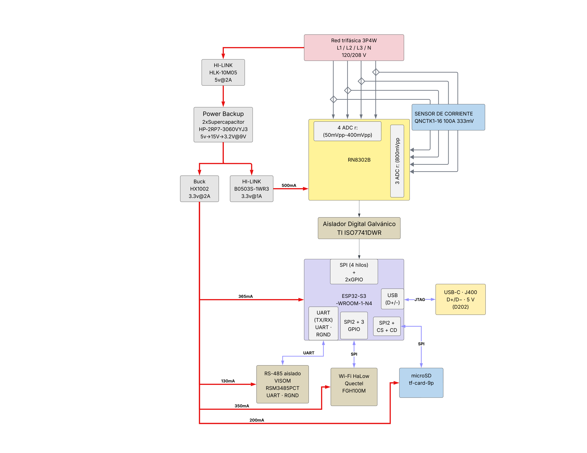
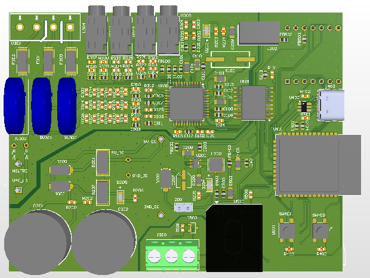
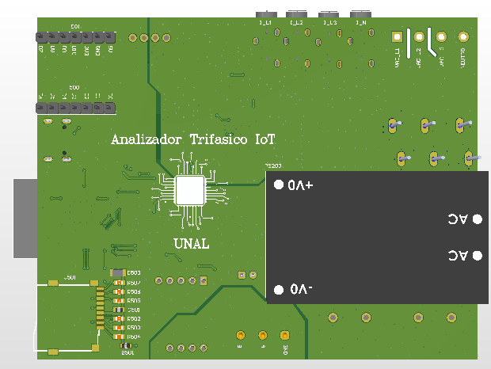
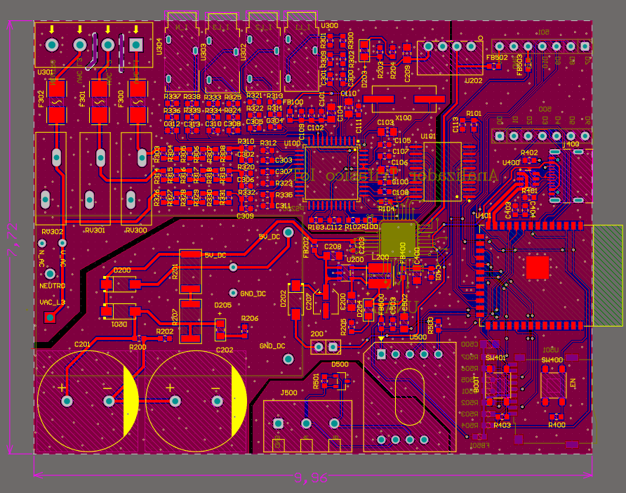

# Analizador Trifásico IoT

> Instrumento electrónico industrial de **medición eléctrica trifásica** con conectividad **IoT**.
> Orientado a instalaciones industriales y motores: registro de consumo, variables eléctricas a múltiples escalas de tiempo, comunicación **Modbus RTU / RS-485** y enlace inalámbrico **Wi-Fi HaLow**.

**Estado del diseño:** esquemáticos y BOM del **15/11/2026**, layout completo con Gerbers generados. Documentación técnica **Rev. 1.1**.

> **Fuente de verdad:** el BOM (`PCB/BOOM/`) y el esquemático (`PCB/SCH/`) definen qué componentes existen; la hoja de datos de cada uno define cuánto consume y hasta dónde llega. Cuando el BOM y la hoja de datos discrepan, prevalece la hoja de datos y la diferencia se registra en `documentation/power-budget/`.

---

## 🧭 Arquitectura



> Versión vectorial: [`Diagrama_Bloques.pdf`](documentation/application-note/Diagrama_Bloques.pdf). El diagrama de la revisión anterior (`documentation/Diagrama_de_bloques_final.*`) se conserva como historial.

---

## 🖥️ Diseño de la PCB

| Cara superior | Cara inferior |
|---|---|
|  |  |

**Capa superior (top layer), con el ruteo completo:**



> Placa de dos capas, 90,96 mm de ancho. El paquete de fabricación está en [`PCB/Gerbers/`](PCB/Gerbers/) y el detalle de disposición en la Sección 8 de la [nota de aplicación](documentation/application-note/application-note.pdf).

---

## 📘 Documentación del proyecto

| Documento | Archivo | Contenido |
|---|---|---|
| Nota de aplicación | [`AN-ATI-001`](documentation/application-note/application-note.pdf) | Arquitectura de hardware, interfaces, PCB y lista de materiales (33 páginas, Rev. 1.1) |
| Presupuesto de potencia | [`PB-ATI-001`](documentation/power-budget/Power_Budget.pdf) | Consumo por riel, cadena de conversión, respaldo, térmica y verificación contra el BOM (20 páginas) |
| Diagrama de bloques | [`PNG`](documentation/application-note/Diagrama_Bloques.png) · [`PDF`](documentation/application-note/Diagrama_Bloques.pdf) | Arquitectura por bloques, interfaces y dominios de referencia |
| Diagrama previo | [`PDF`](documentation/Diagrama_de_bloques_final.pdf) · [`PNG`](documentation/Diagrama_de_bloques_final.png) · [`SVG`](documentation/Diagrama_de_bloques_final.svg) | Revisión anterior, se conserva como historial |
| Reglas de trabajo | [`AGENTS.md`](AGENTS.md) | Convenciones del repositorio y flujo de Git del equipo |

> El diagrama V2 (`documentation/Diagrama de bloquesv2.pdf`, 07/10/2026) se conserva como historial.

---

## 🔧 Arquitectura por bloque

### 1. Entrada de potencia trifásica

| Elemento | Componente | Notas |
|---|---|---|
| Entrada | **Red trifásica L1 / L2 / L3 / N** | **3P4W, 120/208 V** |
| Conector | **U301** — bornera 4 vías, 5 mm | N · L3 · L2 · L1, 10 A |
| Protección | **F300–F302** + **RV300–RV302** | Fusibles 2410 *time-lag* de 200 mA + MOV-14D471K por fase |
| Entrada de CT | **4× HX PJ-320A-3P DIP** (U300, U302, U303, U304) | Tres fases + neutro |

**Conexionado de los jacks de CT:** pin 2 = *tip* (señal), pin 3 = *sleeve* (retorno), pin 4 = *switch*. El pin 4 se une al pin 3 para cortocircuitar el CT cuando no hay plug; al insertar el plug, el switch abre y el CT queda con su burden. Cada pierna lleva **5,1 Ω** (10,2 Ω diferencial), **1 kΩ** en serie y **33 nF** de filtro.

> ⚠️ **Decisión pendiente:** el modelo de CT no está definido. Con un TC de **100 A / 40 mA** hace falta burden de **5,1 Ω** por pierna (577 mVp); con un TC de salida en tensión de **333 mV** no lleva burden. El diagrama de la nota usa 333 mV y el esquemático mantiene la red de 5,1 Ω: hay que unificar.

> Hoja: `THREE PHASES.SchDoc`

### 2. Acondicionamiento analógico

| Elemento | Descripción |
|---|---|
| Canales de tensión | 3 canales diferenciales: **6×165 kΩ + 1 kΩ** por fase, **33 nF** a AGND |
| Canales de corriente | 4 canales diferenciales: red de carga por pierna, **1 kΩ** serie, **33 nF** |
| Rango del AFE | **830 mVp** por canal diferencial |
| Filtrado | RC de entrada y *guard ring* en el layout |

El divisor de tensión usa resistencias de **165 kΩ ±0,1 %** y **1 kΩ** en la base.

> Hoja: `THREE PHASES.SchDoc` (derivaciones) + `MEASURES.SchDoc`

### 3. AFE metrológico

| Elemento | Componente |
|---|---|
| Medidor | **RENERGY RN8302B** (LQFP-44) |
| Canales | 3 de tensión + 4 de corriente, diferenciales |
| Reloj | Cristal **8,192 MHz** (`049ss2-8.192f12dzlal`) |
| Desacople | 10 µF + 100 nF por riel, 1 µF local, ferrita FB100 |
| Alimentación | **AVCC/DVCC 3,3 V** desde el dominio de medida |

Calcula V, I, P, Q, S, PF y THD internamente. El ESP32-S3 lee los registros por SPI a través del ISO7741.

> Hoja: `MEASURES.SchDoc`

### 4. Aislamiento galvánico

| Elemento | Componente | Aislamiento |
|---|---|---|
| Aislador digital | **TI ISO7741DWR** (4 canales, 3/1) | 5000 Vrms |
| Alimentación aislada del AFE | **EVISUN B0503S-1WR3** (5 V → 3,3 V, 1 W, 303 mA) | **1500 VDC** |
| Transceptor RS-485 | **VISOM RSM3485PCT** | 2500 VDC |

**Mapa del SPI aislado:**

| Señal | ESP32-S3 | ISO7741 | RN8302B |
|---|---|---|---|
| MOSI | `IO14` (pin 22) | INA 3 → OUTA 14 | SDI 35 |
| CS | `IO21` (pin 23) | INB 4 → OUTB 13 | SCSN 34 |
| CLK | `IO47` (pin 24) | INC 5 → OUTC 12 | SCLK 33 |
| MISO | `IO48` (pin 25) | OUTD 6 ← IND 11 | SDO 32 |

El dominio de medida queda referenciado a **AGND = N**; el dominio digital a **DGND**; el RS-485 a **RGND**. El ISO7741 y el B0503S son los puentes de la barrera.

> ⚠️ **El eslabón débil es la fuente:** el requisito es **2,5 kVAC** entre medida y comunicación, y el B0503S solo garantiza **1500 VDC**. El conjunto no aísla más que su peor componente.

> Hoja: `MEASURES.SchDoc`

### 5. Procesamiento

| Elemento | Componente |
|---|---|
| MCU | **ESP32-S3-WROOM-1-N4** |
| Programación | **USB-C** (`J400`, 16 pines) — USB nativo / JTAG integrado |
| Monitorización | Puerto serie por USB |
| Arranque | Botones **EN** y **BOOT**, RC de 10 kΩ + 1 µF |

> Hoja: `MCU.SchDoc`

### 6. Alimentación

| Riel | Componente | Capacidad | Destino |
|---|---|---|---|
| AC/DC principal | **PS200 Hi-Link HLK-10M05T** | **5 V @ 2 A** (10 W) | Riel de 5 V y respaldo |
| OR-ing de 5 V y USB | **D200 / D202** (MS2A40LWS) | — | `Vin_buck_5V` |
| Carga del respaldo | **R207** (3,9 Ω / 2 W) + **2×30 F** | 15 F equivalentes | *Last Gasp* |
| OR-ing del respaldo | **D201** (MS2A40LWS) | — | `Vin_buck_5V` |
| Riel digital | **U200 HX1002-GEC** | **3,3 V / 0,7 A** según hoja de datos | ESP32-S3, SD, RS-485, HaLow |
| Riel de medida | **U202 B0503S-1WR3** | **3,3 V @ 1 W aislado** | RN8302B, ISO7741 lado 2 |

#### Presupuesto de consumo del riel de 3,3 V

| Carga | Nominal | Máximo | Origen del dato |
|---|---:|---:|---|
| ESP32-S3-WROOM | 95 mA | 365 mA | Hoja de datos (RX / TX + flash) |
| Quectel FGH100M (VBAT) | 200 mA | 350 mA | **Asignación** — la especificación no publica corrientes |
| microSD | 100 mA | 200 mA | Asignación de diseño |
| VISOM RSM3485PCT | 30 mA | 130 mA | Hoja de datos |
| ISO7741 (lado 1) | 3,2 mA | 4,6 mA | Hoja de datos |
| LEDs y pull-ups | 10 mA | 10 mA | Cálculo |
| **Subtotal `DVCC_3v3`** | **438 mA** | **1 060 mA** | 3,50 W en el peor caso |
| RN8302B + ISO7741 lado 2 + cristal | 7,6 mA | 9,8 mA | Hoja de datos (`AVCC_3v3`) |

Sobre un ciclo de servicio de 60 s, el consumo promedio del riel de 3,3 V es de **713 mW** (el 20 % del peor caso) y la potencia media de entrada **1,04 W**, es decir unos **25 Wh por día**. El perfil y el cálculo completo están en `PB-ATI-001`.

> 🔴 **Hallazgo crítico:** la hoja de datos del `HX1002` garantiza **0,7 A**, no los 1,3 A que declara el parámetro del proveedor en el BOM. Con 1 060 mA de pico el riel queda al **151 %**. Hay que cambiar el buck por uno de al menos 1,6 A o reducir la carga antes de fabricar.

#### Respaldo *Last Gasp*

- Banco: **2×30 F en serie = 15 F**, cargado a ~5,0 V (o 4,58 V si se carga aguas abajo de D200).
- La tensión de corte la fija el buck: 3,3 V de salida + 0,42 V de D201 + caída del interruptor ≈ **3,78 V**.
- Energía útil: **80 J** (50 J si el banco se carga tras D200).
- Autonomía: **25 s a 3,2 W** (80 s a 1 W).
- La carga del banco pasa por **R207** (3,9 Ω / 2 W): desde banco vacío son 1,28 A y **6,4 W** disipados, por encima de su régimen. Es un punto a verificar.

> Hoja: `POWER.SchDoc`

### 7. Periféricos

| Periférico | Componente | Interfaz con el ESP32-S3 | Consumo |
|---|---|---|---|
| **RS-485** | **VISOM RSM3485PCT** | UART `IO17/IO18` + `CON` `IO40` | 30 mA típ. / 130 mA máx. |
| **Wi-Fi HaLow** | **Quectel FGH100M** (módulo externo) | SPI2 + control | 350 mA (asignación) |
| **Almacenamiento** | **microSD** (`tf-card-9p`) | SPI2 compartido, CS `IO38`, CD `IO9` | 100 mA típ. / 200 mA máx. |
| **USB** | **USB-C** `J400` | D−/D+ `IO19/IO20` | — |

**Conexión del módulo HaLow (headers 500/501):**

| Header | Pin | Señal | GPIO |
|---|---:|---|---|
| 500 | 1 | `RST_H` | `IO5` |
| 500 | 2 | `WK_IN_H` | `IO6` |
| 500 | 3 | `SPI_IRQ_H` | `IO7` |
| 500 | 4 | `SPI_CS_H` | `IO10` |
| 501 | 2 | `SPI_CLK_H` | `IO12` |
| 501 | 3 | `SPI_MISO_H` | `IO13` |
| 501 | 4 | `SPI_MOSI_H` | `IO11` |
| 501 | 5 | 3,3 V | — |
| 501 | 6 | DGND | — |
| 501 | 7 | 5 V | — |

La microSD y el FGH100M comparten el bus **SPI2** (`IO11/IO12/IO13`) con CS independientes (`IO38` y `IO10`). El RN8302B tiene un bus **SPI3** dedicado y aislado, por lo que no comparte pines con la SD ni con el HaLow.

> Hojas: `MCU.SchDoc` + `INTERFACES.SchDoc`

---

## 📌 Mapa de interfaces del ESP32-S3-WROOM

| Interfaz | Pines | Hacia |
|---|---|---|
| SPI3 aislado del AFE | `IO14` MOSI, `IO21` CS, `IO47` CLK, `IO48` MISO | RN8302B vía ISO7741 |
| SPI2 de microSD / HaLow | `IO11` MOSI, `IO12` CLK, `IO13` MISO | microSD (`CS IO38`) y FGH100M (`CS IO10`) |
| UART RS-485 | `IO17` TX, `IO18` RX, `IO40` CON | RSM3485PCT |
| Control HaLow | `IO5` RST, `IO6` WAKE, `IO7` IRQ | Headers 500/501 |
| USB | `IO19` D−, `IO20` D+ | USB-C `J400` |
| Arranque | `IO0` BOOT, pin 3 EN | Botones y RC |
| Tarjeta SD | `IO9` CD | Conector microSD |

---

## ⚡ Arquitectura de energía

```
Red 3P4W 120/208 V
        │
        └──► U301 ─► F300 ─► PS200 HLK-10M05T (5 V @ 2 A)
                                   │
                                   ├──► R207 (3,9 Ω) ─► 2×30 F ─► D201 ─┐
                                   │                                    │
                                   └──► D200 ───────────────────────────┤
                                                                        ├──► Vin_buck_5V
                                   USB-C 5 V ─► D202 ───────────────────┘
                                                                        │
                              ┌─────────────────────────────────────────┤
                              │                                         │
                              ▼                                         ▼
                    U200 HX1002 (buck)                        U202 B0503S (aislado)
                    3,3 V digital · 0,7 A                     3,3 V @ 1 W · 1500 VDC
                              │                                         │
                              ▼                                         ▼
          ESP32-S3 · microSD · RS-485 · HaLow                RN8302B + ISO7741
```

El **HLK-10M05T** es la única fuente AC/DC y alimenta el riel de 5 V. Tres diodos Schottky hacen OR-ing sobre `Vin_buck_5V`: la fuente, el banco de supercapacitores y el USB-C. Desde ese nodo cuelgan el buck digital y el DC-DC aislado del AFE.

---

## 🧪 Prueba de concepto

Antes de fabricar se validó la cadena de medida con una tarjeta **EVALSTPM34-V3** (STPM34, doble fase, clase 0,2) enlazada por **UART** a una ESP32-S3, con un panel web que grafica tensión, corriente, potencia activa, reactiva y frecuencia. La prueba confirmó el enlace, el escalado y el panel; no valida el RN8302B, la topología 3P4W ni la barrera galvánica. El detalle está en la Sección 9 de la nota de aplicación.

Material en `references/reference-designs/EVALLSTPM34-V3/`.

---

## 🗂️ Estructura del repositorio

```
Analizador trifasico IoT/
├── README.md
├── AGENTS.md                       ← reglas del repositorio y flujo de Git
├── .gitignore / .gitattributes
│
├── hardware/
│   ├── altium/                     ← Proyecto Altium Designer
│   │   ├── Analizador_trifasico_IoT_pcb.PrjPcb
│   │   ├── MAIN.SchDoc             ← hoja raíz
│   │   ├── THREE PHASES.SchDoc     ← entrada trifásica, CT y divisores
│   │   ├── POWER.SchDoc            ← alimentación, respaldo y rieles
│   │   ├── MEASURES.SchDoc         ← RN8302B + ISO7741 + cristal
│   │   ├── MCU.SchDoc              ← ESP32-S3, USB-C, EN/BOOT
│   │   ├── INTERFACES.SchDoc       ← RS-485, microSD, headers HaLow
│   │   └── Analizador_PCB.PcbDoc   ← layout
│   │
│   └── libraries/                  ← Biblioteca única del proyecto
│       ├── Library_Analizador.LibPkg
│       ├── Schlib1.SchLib
│       ├── PcbLib1.PcbLib
│       └── Library_Analizador.IntLib
│
├── PCB/
│   ├── SCH/                        ← esquemático completo en PDF
│   ├── BOOM/                       ← BOM exportado del proyecto
│   ├── Gerbers/                    ← paquete de fabricación
│   ├── Analizador_PCB.png          ← vistas del layout
│   ├── Top_Layer.png
│   └── CAMtastic1.Cam
│
├── documentation/
│   ├── application-note/           ← nota de aplicación (LaTeX + PDF + figuras)
│   ├── power-budget/               ← presupuesto de potencia (LaTeX + PDF)
│   ├── Diagrama_de_bloques_final.pdf / .png / .svg
│   ├── Diagrama de bloquesv2.pdf   ← historial
│   ├── wifi-module-halow-xiao/     ← documentación del módulo HaLow
│   └── RD_EM_01_Industrial_Energy_Monitor.pdf
│
├── references/
│   ├── datasheets/
│   ├── application-notes/
│   └── reference-designs/          ← EVALSTPM34-V3, ADE9430, FGH100M, etc.
│
└── software/                       ← herramientas de visualización y pruebas
```

---

## 🔌 Hojas del esquemático

| # | Archivo | Contenido | Componentes clave |
|---|---|---|---|
| 1 | `MAIN.SchDoc` | Hoja raíz: solo *sheet symbols* | — |
| 2 | `THREE PHASES.SchDoc` | Entrada trifásica, CT y divisores | U301, F300–F302, RV300–RV302, U300/U302/U303/U304, R303–R339, C300–C313 |
| 3 | `POWER.SchDoc` | Alimentación, respaldo y rieles | PS200, D200/D201/D202, R207, 2×30 F, U200, U202 |
| 4 | `MEASURES.SchDoc` | AFE metrológico y aislamiento | U100 RN8302B, U101 ISO7741, cristal 8,192 MHz |
| 5 | `MCU.SchDoc` | Procesamiento y USB | U401 ESP32-S3-WROOM-1-N4, J400 USB-C, EN/BOOT |
| 6 | `INTERFACES.SchDoc` | Comunicaciones y almacenamiento | U500 RSM3485PCT, U501 microSD, headers 500/501, D500 SM712 |

---

## 📚 Referencias técnicas

### `references/datasheets/`

| Archivo | Componente |
|---|---|
| `RN8302B_Datasheet_v3.pdf` · `RN8302B_User_Manual_v1.1.pdf` | RENERGY RN8302B — AFE metrológico |
| `ESP32-S3_Datasheet_en.pdf` · `ESP32-S3_Technical_Reference_Manual_en.pdf` | Espressif ESP32-S3 |
| `ESP32-S3-WROOM_Module.pdf` | Módulo ESP32-S3-WROOM-1-N4 |
| `ISO7741DWR_Datasheet.pdf` | TI ISO7741 — aislador digital |
| `EVISUN B0503S-1WR3.pdf` | B0503S-1WR3 — DC-DC aislado 1 W |
| `HX1002-GEC_Datasheet.pdf` | HX1002 — buck 3,3 V / 0,7 A |
| `HLK-10M05_Datasheet.pdf` | Hi-Link HLK-10M05T — AC/DC 5 V 2 A |
| `RSM3485PCT_Datasheet.pdf` | VISOM RSM3485PCT — RS-485 aislado |
| `Supercapacitor_Datasheet.pdf` | HP-2R7-J306VYJ23 — 30 F / 2,7 V |
| `JFC2410-0200TS_Datasheet.pdf` | Fusible 2410 time-lag |
| `MOV-14D471K_Datasheet.pdf` | Varistor MOV-14D471K |
| `MS2A40LWS_Datasheet.pdf` | Schottky de OR-ing |
| `AP63203WU-7_Datasheet.pdf` · `TI TPS2553DRVR.pdf` | **Alternativas evaluadas, no están en el BOM** |

### `references/reference-designs/`

| Carpeta | Contenido |
|---|---|
| `EVALLSTPM34-V3/` | Tarjeta de evaluación STPM34 — documentación y prueba de concepto |
| `EVAL-ADE9430/` | Analog Devices EVAL-ADE9430 — referencia de AFE trifásico |
| `WI-FI_HALOW_FGH100M_EXT01_V30/` | Módulo HaLow: PCB, esquemático y librerías |
| `HX PJ-320A-3P DIP/` | Conector de entrada de CT |

---

## 🚀 Cómo empezar a colaborar

### Ciclo de trabajo

```bash
git checkout main
git pull
git checkout -b feature/mi-tarea
# ... trabajar en Altium, guardar y CERRAR ...
git status
git add .
git commit -m "MEASURES: ajusta rango de ADC de corriente"
git push -u origin feature/mi-tarea
# → Pull Request en GitHub → revisión → merge → borrar rama
```

Si `main` avanzó antes del merge:

```bash
git checkout main && git pull
git checkout feature/mi-tarea
git merge main
git push
```

> ⚠️ **Cierra Altium antes de `git pull`, `git checkout` o `git merge`.** Si está abierto, sobrescribe el archivo al guardar y se pierde el trabajo del compañero.

### Reglas de colaboración

Los archivos `.SchDoc`, `.PcbDoc`, `.SchLib` y `.PcbLib` son **binarios** (contenedores OLE2):

| Git **SÍ** puede | Git **NO** puede |
|---|---|
| Guardar el historial completo | Mostrar diffs de contenido (`Binary files differ`) |
| Revertir a cualquier versión | Fusionar cambios automáticamente |
| Crear ramas independientes | Resolver conflictos de merge |

1. **Una persona por archivo a la vez.** En especial `Analizador_PCB.PcbDoc` — es monolítico.
2. **Una rama por tarea**, nunca trabajes directamente en `main`.
3. **Nunca dos personas en la misma rama ni el mismo archivo en dos ramas.**
4. **Cierra Altium antes de cualquier operación de Git.**
5. **Si hay conflicto de merge en un binario**, no lo edites a mano: coordina con el compañero y rehaz el cambio en Altium sobre la versión que quede en `main`.

> El detalle de las reglas de hardware y del flujo de trabajo está en [`AGENTS.md`](AGENTS.md).

---

## 📄 Convención de commits

```
<hoja o bloque>: <descripción corta en imperativo>

THREE PHASES: ajusta entrada de CT
POWER: actualiza respaldo de supercaps
MEASURES: ajusta desacople del RN8302B
MCU: conecta SPI de la microSD
INTERFACES: ordena headers del HaLow
PCB: enruta zona de potencia
LIB: actualiza símbolo del RSM3485PCT
DOC: actualiza diagrama de bloques final
```

---

## 📊 Estado del proyecto

**Diseño y documentación**
- [x] Esquemáticos de las 6 hojas capturados (15/11/2026)
- [x] BOM y netlist del proyecto — **148 componentes**
- [x] Layout completo y paquete de Gerbers generado
- [x] Biblioteca única del proyecto
- [x] Nota de aplicación AN-ATI-001 Rev. 1.1
- [x] Presupuesto de potencia PB-ATI-001
- [x] Prueba de concepto con EVALSTPM34 y panel de telemetría

**Verificaciones de cierre antes de fabricar**

| Tema | Verificación | Estado |
|---|---|---|
| Buck U200 | El HX1002 entrega 0,7 A y la carga pico es 1,06 A. Cambiar por uno de ≥1,6 A o reducir la carga. | 🔴 Crítico |
| R207 | Disipa 6,4 W desde banco vacío sobre 2 W nominales. Verificar o volver a un interruptor limitador. | ⚠️ Revisar |
| Fusible F300 | I²t de 0,0682 A²s frente a una irrupción de hasta 10 A; el fabricante del HLK recomienda 1 A. | ⚠️ Revisar |
| Aislamiento | El B0503S aporta 1500 VDC frente al requisito de 2,5 kVAC. | ⚠️ Revisar |
| CT | Elegir entre 100 A / 40 mA (burden 5,1 Ω) o 333 mV (sin burden) y unificar esquemático y nota. | ⚠️ Pendiente |
| FGH100M | La especificación no publica corrientes; medir el módulo y confirmar la rama `VDD_FEM` de 5 V. | ⚠️ Pendiente |
| BOM | Corregir el part number de C400 (figura el del cristal) y reexportar. | ⚠️ Pendiente |
| Entrada | Confirmar 120/208 V, coordinación de F300 con el HLK y U301/PE. | Pendiente |
| Altium | ERC/DRC, huellas y `Library_Analizador.IntLib`. | Pendiente |
| EMC / seguridad | Filtro EMI, ESD y definición del gabinete (Clase I/II). | Pendiente |
| Producción | Test points, fiduciales y revisión de Gerbers. | Pendiente |

> Los cálculos y el detalle de cada verificación están en `PB-ATI-001` y en la Sección 10 de la nota de aplicación.

---

## 📄 Licencia

Proyecto académico — Universidad Nacional de Colombia, Facultad de Ingeniería.
Uso académico. Verificar autorización institucional antes de cualquier distribución pública.

---

## 🔗 Enlaces útiles

- [Altium — Git Version Control](https://www.altium.com/documentation/altium-designer/using-external-version-control/git)
- [Altium — Using External Version Control](https://www.altium.com/documentation/altium-designer/using-external-version-control)
- [KiCad — importación de archivos Altium](https://dev-docs.kicad.org/en/import-formats/altium/index.html)
